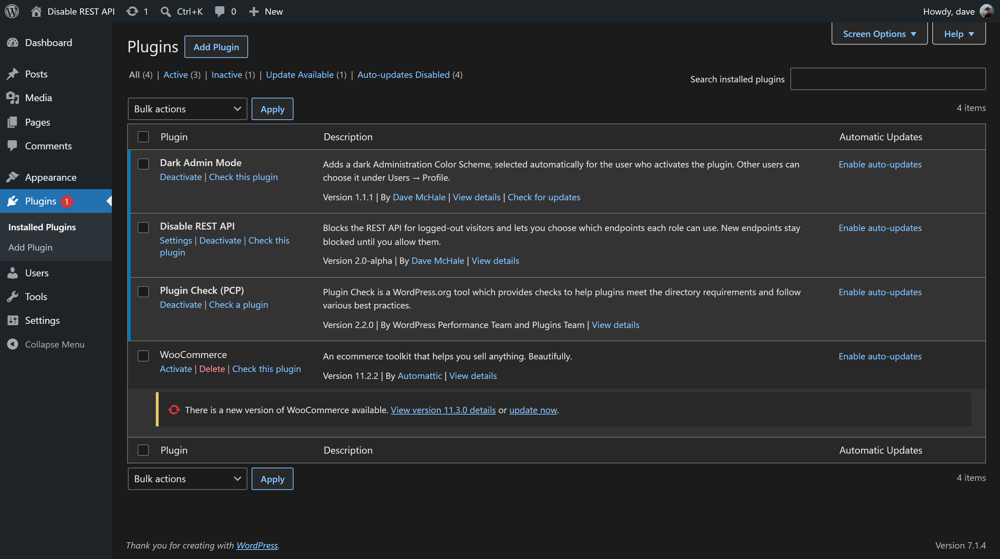
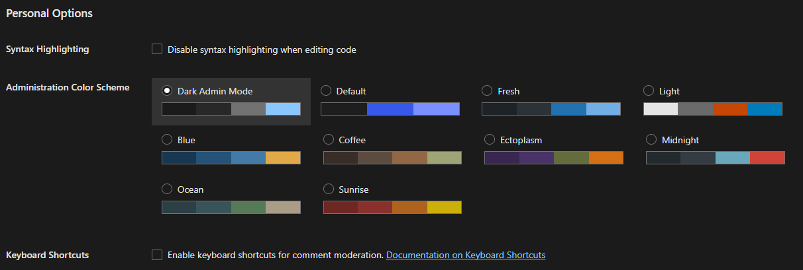

# Dark Admin Mode

A dark Administration Color Scheme for the WordPress admin. Each user opts in from Users → Profile; activating the plugin selects it for the activating user only, and deactivating restores everyone's previous scheme.

Install `dark-admin-mode.zip` from the [latest release](https://github.com/dmchale/dark-admin-mode/releases/latest) (not the "Source code" zips, which unpack under the wrong folder name). Installed sites update from GitHub Releases through the bundled [Plugin Update Checker](https://github.com/YahnisElsts/plugin-update-checker) (`lib/`, MIT).

## Screenshots





## Development

Plain PHP and CSS loaded directly by WordPress; there's no build step.

```bash
composer install          # dev tooling only (PHPCS); nothing in vendor/ ships
vendor/bin/phpcs          # coding standards (.phpcs.xml.dist)
bin/plugin-check.sh       # builds the release copy (minus .distignore), runs Plugin Check, then zips it to build/dark-admin-mode.zip
```

## License

GPL-2.0-or-later. Bundled Plugin Update Checker: MIT (`lib/plugin-update-checker/license.txt`).
